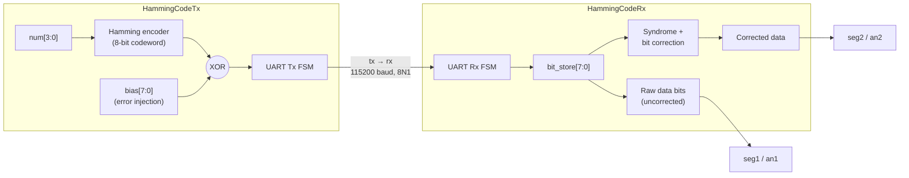

# UART-Data-Correction

Single-bit error correction over UART using a **Hamming(7,4) code with an extra parity bit**, implemented in Verilog for FPGA.

A transmitter encodes a 4-bit number into an 8-bit Hamming frame, optionally **injects a deliberate bit error**, and sends it over UART. A receiver decodes the frame, **detects and corrects** the flipped bit, and shows both the raw (possibly corrupted) value and the corrected value on seven-segment displays.

This repository contains the Verilog source, setup diagrams and flowcharts for the project.

---

## Table of contents

- [Features](#features)
- [Repository contents](#repository-contents)
- [How it works](#how-it-works)
  - [System overview](#system-overview)
  - [Frame format](#frame-format)
  - [Encoding (Tx)](#encoding-tx)
  - [Decoding and correction (Rx)](#decoding-and-correction-rx)
  - [UART configuration](#uart-configuration)
- [Module interfaces](#module-interfaces)
- [Hardware setup](#hardware-setup)
- [Usage](#usage)
- [Worked example](#worked-example)
- [Limitations and possible improvements](#limitations-and-possible-improvements)

---

## Features

- Hamming(7,4) encoder with an additional overall-parity bit so the codeword fills one full 8-bit UART frame
- Programmable **error injection**: an 8-bit `bias` input is XORed onto the codeword, so any bit pattern can be flipped on demand
- Rising-edge triggered transmission via a push button
- UART transmitter and receiver written as explicit finite state machines (8N1, 115200 baud, 100 MHz clock)
- Syndrome-based single-bit error correction on the receiver
- Live display of the **original** value (Tx), the **received** value (Rx, uncorrected) and the **corrected** value (Rx) on multiplexed seven-segment displays

## Repository contents

| File | Description |
| --- | --- |
| `HammingCodeTx.v` | Transmitter: Hamming encoder, error injection, UART Tx FSM, seven-segment display of the input value |
| `HammingCodeRx.v` | Receiver: UART Rx FSM, syndrome calculation, error correction, two seven-segment display drivers (raw and corrected) |
| `README.md` | This file |

<!-- Add your setup diagrams and flowcharts here, for example:

-->

---

## How it works

### System overview

### Frame format

Each UART frame carries one 8-bit codeword, sent **LSB first**:

| Bit index | 7 | 6 | 5 | 4 | 3 | 2 | 1 | 0 |
| --- | --- | --- | --- | --- | --- | --- | --- | --- |
| Content | P5 | D3 | D2 | D1 | P4 | D0 | P2 | P1 |
| Hamming position | – | 7 | 6 | 5 | 4 | 3 | 2 | 1 |

`D0`–`D3` are the data bits (`num[0]`–`num[3]`), `P1`, `P2`, `P4` are the Hamming parity bits, and `P5` is an overall even-parity bit over the other seven bits. The code only needs 7 bits; `P5` pads the codeword to 8 bits because UART sends a full byte.

### Encoding (Tx)

Each parity bit covers a different subset of the data bits:

| Parity bit | Covers | Equation |
| --- | --- | --- |
| P1 | D0, D1, D3 | `num[0] ^ num[1] ^ num[3]` |
| P2 | D0, D2, D3 | `num[0] ^ num[2] ^ num[3]` |
| P4 | D1, D2, D3 | `num[1] ^ num[2] ^ num[3]` |
| P5 | all 7 bits | `P1 ^ P2 ^ P4 ^ D0 ^ D1 ^ D2 ^ D3` |

The codeword is then XORed with `bias` (`Edata = data ^ bias`) before transmission. With `bias = 8'h00` the frame goes out clean; setting a bit in `bias` flips the corresponding bit of the frame.

### Decoding and correction (Rx)

The receiver latches the 8 received bits into `bit_store` at the end of each frame and recomputes three parity checks:

| Check | Bits checked |
| --- | --- |
| `n1` | `bit_store[0]`, `[2]`, `[4]`, `[6]` |
| `n2` | `bit_store[1]`, `[2]`, `[5]`, `[6]` |
| `n3` | `bit_store[3]`, `[4]`, `[5]`, `[6]` |

The 3-bit syndrome `{n3, n2, n1}` is the **position of the erroneous bit** (1 to 7), or `000` if no single-bit error is detected. The receiver flips that bit and extracts the data:

| Syndrome | Bit flipped in `bit_store` | Meaning |
| --- | --- | --- |
| `000` | none | No error |
| `001` | `[0]` | P1 |
| `010` | `[1]` | P2 |
| `011` | `[2]` | D0 |
| `100` | `[3]` | P4 |
| `101` | `[4]` | D1 |
| `110` | `[5]` | D2 |
| `111` | `[6]` | D3 |

Corrected data is `{corrected[6], corrected[5], corrected[4], corrected[2]}` = `{D3, D2, D1, D0}`.

### UART configuration

| Parameter | Value |
| --- | --- |
| Format | 8 data bits, no parity, 1 stop bit (8N1) |
| Bit order | LSB first |
| Baud rate | 115200 |
| Clock | 100 MHz |
| Clocks per bit | 868 (`100 000 000 / 115 200`) |

The Tx FSM runs through `idle → start_bit → data_bits → stop_bit → cleanup`. The Rx FSM uses the same states, detects the falling edge of the start bit, re-checks it at mid-bit, then samples each data bit once per bit period. An `indicator` pulse at the end of the stop bit latches the received byte.

---

## Module interfaces

### `HammingCodeTx`

| Port | Dir | Width | Description |
| --- | --- | --- | --- |
| `clk` | in | 1 | 100 MHz system clock |
| `rst` | in | 1 | Asynchronous reset (active high) |
| `num` | in | 4 | Value to transmit (0–15) |
| `bias` | in | 8 | Error-injection mask XORed onto the codeword |
| `trig` | in | 1 | Starts a transmission on its rising edge |
| `tx` | out | 1 | UART serial output (idle high) |
| `seg1` | out | 7 | Seven-segment cathodes showing `num` |
| `an1` | out | 4 | Seven-segment anodes (active low) |

### `HammingCodeRx`

| Port | Dir | Width | Description |
| --- | --- | --- | --- |
| `clk` | in | 1 | 100 MHz system clock |
| `rst` | in | 1 | Asynchronous reset (active high) |
| `rx` | in | 1 | UART serial input |
| `seg1`, `an1` | out | 7, 4 | Display of the **received, uncorrected** data value |
| `seg2`, `an2` | out | 7, 4 | Display of the **corrected** data value |

Both modules multiplex their displays using the top two bits of a 20-bit refresh counter (roughly 95 Hz refresh per digit set at 100 MHz). Values are shown in decimal across the four digits, e.g. `0013`.

---

## Hardware setup

The design targets the **Boolean FPGA board** (100 MHz clock, two 4-digit seven-segment displays). The Rx file was written with that board's constraints in mind.

1. Map `num[3:0]`, `bias[7:0]` and `rst` to switches, and `trig` to a push button.
2. Map `seg1`/`an1` (and `seg2`/`an2` on the receiver) to the seven-segment display pins.
3. Connect the transmitter's `tx` pin to the receiver's `rx` pin. If Tx and Rx are on **separate boards**, also connect a common ground.
4. Add a constraints file (`.xdc`) for your board with the pin assignments above and a 100 MHz clock constraint.

If you use a different clock frequency, update `clk_speed` in `HammingCodeTx.v` and `clk_cycles` in `HammingCodeRx.v` (`clk_speed / baud_rate`) so both sides keep the same baud rate.

## Usage

1. Synthesise and program `HammingCodeTx` onto the transmitter board and `HammingCodeRx` onto the receiver board (for example with Xilinx Vivado).
2. Pulse `rst` on both boards.
3. Set `num` to the value you want to send (0–15). It appears on the Tx display.
4. Set `bias` to the error you want to inject:
   - `00000000`: no error
   - one bit set: a single-bit error (correctable)
   - two or more bits set: a multi-bit error (see [limitations](#limitations-and-possible-improvements))
5. Press `trig`. The frame is transmitted once per button press.
6. Read the Rx displays: `seg1`/`an1` show the received value as-is, `seg2`/`an2` show the value after correction.

## Worked example

Send `num = 13` (`4'b1101`, so D3=1, D2=1, D1=0, D0=1) with an error injected on bit 4 (`bias = 8'b0001_0000`, i.e. D1).

| Step | Value |
| --- | --- |
| Parity bits | P1 = 0, P2 = 1, P4 = 0, P5 = 0 |
| Clean codeword `{P5,D3,D2,D1,P4,D0,P2,P1}` | `0110_0110` |
| After error injection (`^ 0001_0000`) | `0111_0110` |
| Rx raw data `{D3,D2,D1,D0}` | `1111` → **15** (wrong) |
| Syndrome `{n3,n2,n1}` | `101` → bit 4 is in error |
| Rx corrected data | `1101` → **13** (correct) |

So the Rx displays show **15** on the raw display and **13** on the corrected display.

---

## Limitations and possible improvements

- **Single-bit correction only.** Two or more flipped bits can produce a wrong syndrome, and the receiver will silently "correct" to the wrong value.
- **The overall parity check is not yet used.** `HammingCodeRx.v` already computes `n4` (parity over all 8 received bits) but does not act on it. Combining `n4` with the syndrome would turn the code into SECDED (single-error correct, double-error detect) and let the receiver flag uncorrectable frames. Flipping only bit 7 (`P5`) currently has no visible effect.
- **4-bit payload.** Only values 0–15 are supported per frame.
- **Fixed timing.** The receiver's `clk_cycles` is hard-coded to 868 and assumes a 100 MHz clock.
- **No stop-bit or framing-error check** on the receiver.
- The `trig` input is edge-detected rather than fully debounced, so a bouncy button may cause repeated transmissions.
